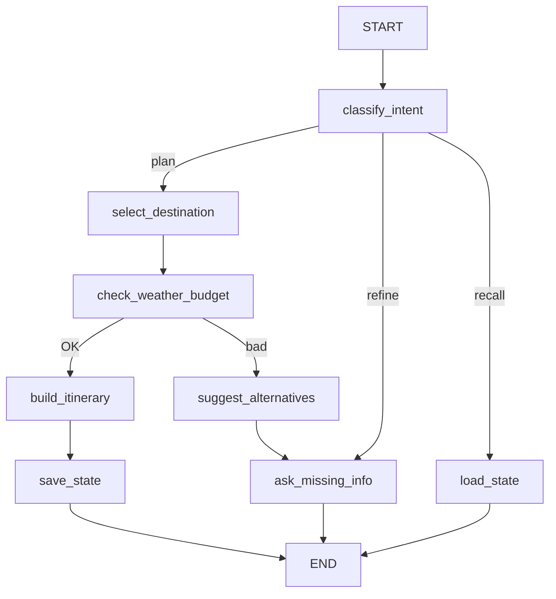

# Travel Planner — ИИ-агент для планирования путешествий

> Агент на базе LangGraph с внешними инструментами, памятью и FastAPI-интерфейсом.

## Возможности

- **Классификация намерений** — определяет, хочет ли пользователь спланировать поездку, уточнить план или восстановить сохранённый
- **Выбор направления** — подбирает курорт с учётом сезона, активности и бюджета
- **Уточнение параметров** — запрашивает недостающие данные (даты, бюджет, комфорт)
- **Внешние инструменты:**
  - 🌤️ Погода (Open-Meteo API) — температура, осадки, сезонные риски
  - 💰 Стоимость поездки (справочник) — перелёт, проживание, питание, развлечения
  - 💱 Курсы валют (exchangerate-api.com)
  - 🏨 Цены на жильё (хостелы, отели, апартаменты, виллы)
  - ✈️ Варианты транспорта (авиа, ж/д, автобус, аренда)
- **Память** — краткосрочная (InMemorySaver) и долгосрочная (JSON-файлы)
- **FastAPI-интерфейс** — синхронный и стриминговый (SSE)
- **Gradio UI** — интерактивный чат с полем для API-ключа

## Архитектура

Граф имеет 8 узлов и 2 условных ребра (3+ пути выполнения):



## Быстрый старт

### 1. Установка зависимостей

```bash
pip install -r requirements.txt
```

### 2. Настройка API-ключа

```bash
export GIGACHAT_KEY="ваш_ключ"
```

### 3. Запуск

**Вариант A — FastAPI-сервис:**
```bash
uvicorn app:app --reload --port 8000
```

**Вариант B — Gradio UI:**
```bash
python chat_ui.py
```

**Вариант C — jupyter notebook:**
```bash
jupyter notebook travel_planner.ipynb
```

## API-эндпоинты

| Метод | URL | Описание |
|-------|-----|----------|
| POST | `/chat` | Основной вход (синхронный) |
| POST | `/chat/stream` | Стриминг через SSE |
| GET | `/state/{session_id}` | Получение состояния сессии |
| POST | `/reset/{session_id}` | Очистка сессии |
| GET | `/health` | Health-check |

## Пример запроса

```bash
curl -X POST http://localhost:8000/chat \
  -H "Content-Type: application/json" \
  -d '{"message": "Хочу поехать в тепло в феврале"}'
```

## Примеры запросов

- «Хочу на горнолыжный курорт в начале апреля из Нижнего Новгорода»
- «Пляжный отдых в феврале, бюджет 70 000 рублей»
- «Тропики и море на неделю, премиум уровень»
- «Бюджетно и недалеко — куда поехать в марте?»
- «Хочу в Иорданию на 5 дней, стандартный комфорт»

## Структура проекта

```
vtroshin/
├── app.py              # FastAPI-сервис
├── chat_ui.py          # Gradio UI
├── travel_planner.ipynb # Ноутбук с демонстрацией
├── requirements.txt    # Зависимости
├── .gitignore
└── README.md
```
