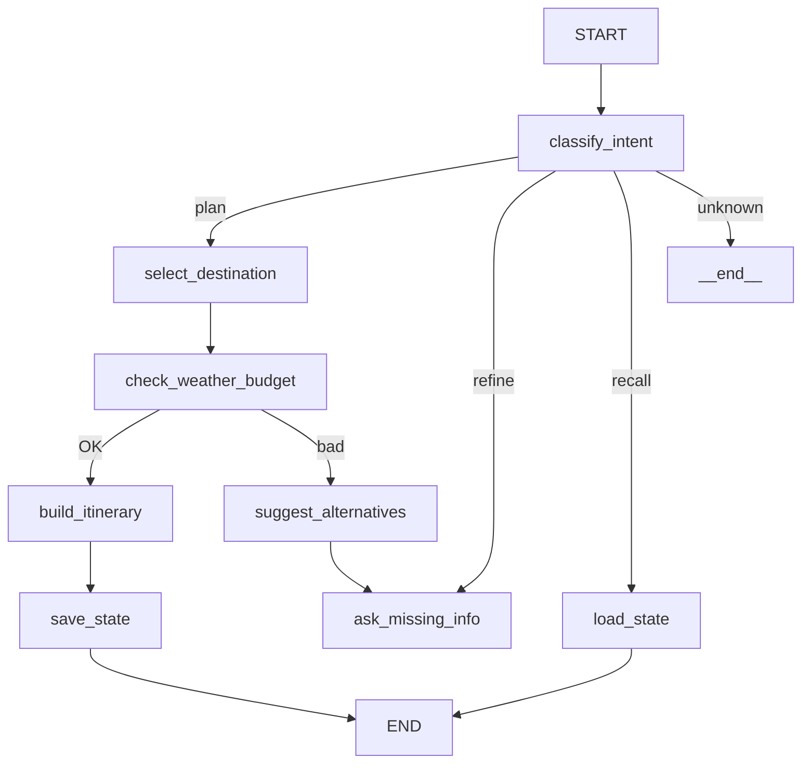

# Travel Planner — ИИ-агент для планирования путешествий

> Агент на базе LangGraph с внешними инструментами, памятью и FastAPI-интерфейсом.

## Возможности

- **Классификация намерений** — определяет, хочет ли пользователь спланировать поездку, уточнить план или восстановить сохранённый
- **Выбор направления** — подбирает курорт с учётом сезона, активности и бюджета
- **Уточнение параметров** — запрашивает недостающие данные (даты, бюджет, комфорт)
- **Внешние инструменты (2 реальных API):**
  - 🌤️ Погода (Open-Meteo API) — температура, осадки, сезонные риски
  - 💱 Курсы валют (exchangerate-api.com) — актуальные USD/EUR → RUB
- **LLM-генерация** — стоимость, жильё, транспорт формируются моделью в итоговом плане
- **Память** — краткосрочная (InMemorySaver) и долгосрочная (JSON-файлы)
- **FastAPI-интерфейс** — синхронный и стриминговый (SSE)
- **Gradio UI** — интерактивный чат с полем для API-ключа

## Архитектура

Граф имеет **8 узлов** и **2 условных ребра** (5 путей выполнения):



### Узлы графа

| # | Узел | Модель | Описание |
|---|------|--------|----------|
| 1 | `classify_intent` | GigaChat-3-Pro | Классификация намерения: plan / refine / recall / unknown |
| 2 | `select_destination` | GigaChat-3-Pro | Выбор направления через LLM (без хардкода) |
| 3 | `ask_missing_info` | GigaChat-3-Pro | Запрос недостающих параметров |
| 4 | `load_state` | GigaChat-3-Pro | Восстановление состояния из JSON |
| 5 | `check_weather_budget` | — | Проверка погоды + стоимости + бюджета |
| 6 | `suggest_alternatives` | GigaChat-3-Pro | Предложение альтернатив при плохой погоде/бюджете |
| 7 | `build_itinerary` | GigaChat3.5-Reasoning | Детальное составление маршрута |
| 8 | `save_state` | — | Сериализация состояния в JSON |

## Быстрый старт

### 1. Установка зависимостей

```bash
pip install -r requirements.txt
```

### 2. Настройка API-ключа

```bash
export GIGACHAT_KEY="ваш_ключ"
```

### 3. Запуск

**Вариант A — FastAPI-сервис:**
```bash
uvicorn app:app --reload --port 8000
```

**Вариант B — Gradio UI:**
```bash
python chat_ui.py
```

**Вариант C — jupyter notebook:**
```bash
jupyter notebook travel_planner.ipynb
```

## API-эндпоинты

| Метод | URL | Описание |
|-------|-----|----------|
| POST | `/chat` | Основной вход (синхронный) |
| POST | `/chat/stream` | Стриминг через SSE |
| GET | `/state/{session_id}` | Получение состояния сессии |
| POST | `/reset/{session_id}` | Очистка сессии |
| GET | `/health` | Health-check |

## Пример запроса

```bash
curl -X POST http://localhost:8000/chat \
  -H "Content-Type: application/json" \
  -d '{"message": "Хочу поехать в тепло в феврале"}'
```

## Примеры запросов

- «Хочу на горнолыжный курорт в начале апреля из Нижнего Новгорода»
- «Пляжный отдых в феврале, бюджет 70 000 рублей»
- «Тропики и море на неделю, премиум уровень»
- «Бюджетно и недалеко — куда поехать в марте?»
- «Хочу в Иорданию на 5 дней, стандартный комфорт»

## Структура проекта

```
├── app.py              # FastAPI-сервис
├── chat_ui.py          # Gradio UI
├── requirements.txt    # Зависимости
├── .gitignore
└── README.md
```

## Внешние API

| # | Инструмент | API | Описание |
|---|-----------|-----|----------|
| 1 | `get_weather_forecast` | Open-Meteo | Прогноз погоды: температура, осадки |
| 2 | `get_exchange_rates` | exchangerate-api.com | Курсы валют USD/EUR → RUB |

## Критерии курса

| # | Критерий | Статус |
|---|----------|--------|
| 1 | Агент на LLM GigaChat | ✅ GigaChat-3-Pro + GigaChat3.5-Reasoning |
| 2 | LangGraph | ✅ StateGraph с 8 узлами |
| 3 | Минимум 2 внешних API | ✅ 2 реальных API + LLM-генерация |
| 4 | Сохранение состояния | ✅ InMemorySaver + JSON-файлы |
| 5 | Сложный роутинг (3+ пути) | ✅ 5 путей через 2 условных ребра |
| 6 | FastAPI | ✅ 5 эндпоинтов, стриминг SSE |
