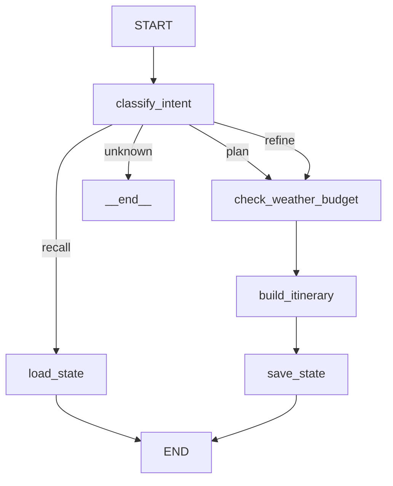

# Travel Planner — ИИ-агент для планирования путешествий

> Агент на базе LLM GigaChat + LangGraph с внешними инструментами, памятью и FastAPI-интерфейсом.

## User Story

**Как** путешественник, я хочу быстро спланировать поездку, чтобы получить детальный маршрут с учётом бюджета, погоды и моих интересов.

**Сценарий использования:**

1. Пользователь отправляет `/plan_create` с параметрами поездки
2. Агент проверяет погоду и курсы валют через внешние API
3. LLM генерирует детальный план с транспортом, жильём и развлечениями
4. План сохраняется в JSON-файл
5. Пользователь может обновить план через `/plan_update`

**Пример:**
```
/plan_create {"destination": "Шерегеш", "departure_city": "Нижний Новгород", "dates": "2027-04-01,2027-04-06", "budget": 150000, "passengers": 2, "comfort_level": "стандарт", "transport": "авиа", "interests": "сноубординг", "special_requests": "нужна аренда сноубордов и ботинок, остальное снаряжение есть"}
```

## Возможности

- **Команды с JSON** — `/plan_create` (новый план) и `/plan_update` (обновление)
- **Внешние инструменты (3 общедоступных API, без ключей):**
  - 🌤️ Погода (Open-Meteo API) — температура, осадки, сезонные риски
  - 💱 Курсы валют (exchangerate-api.com) — актуальные USD/EUR → RUB
  - 📍 Геокодинг (Nominatim / OpenStreetMap) — координаты и страна по названию города
- **Агентный цикл** — LLM решает, какие внешние API вызвать, и собирает результат
- **LLM-генерация** — стоимость, жильё, транспорт формируются моделью на основе реальных данных из API
- **Память** — краткосрочная (InMemorySaver) и долгосрочная (JSON-файлы)
- **FastAPI-интерфейс** — синхронный
- **Gradio UI** — интерактивный чат с полем для API-ключа

## Архитектура

Граф имеет **5 узлов** и **1 условное ребро** (4 пути выполнения):



### Узлы графа

| # | Узел | Модель | Описание |
|---|------|--------|----------|
| 1 | `classify_intent` | — | Парсинг команд /plan_create и /plan_update, фильтрация запросов |
| 2 | `load_state` | — | Восстановление состояния из JSON |
| 3 | `check_weather_budget` | GigaChat-3-Pro | Агентный цикл: LLM вызывает внешние API |
| 4 | `build_itinerary` | GigaChat-3-Pro | Детальное составление маршрута |
| 5 | `save_state` | — | Сериализация состояния в JSON |

## Путь выполнения

| Путь | Сценарий |
|------|----------|
| 1 | Создать план: `classify_intent → check_weather_budget → build_itinerary → save_state → END` |
| 2 | Обновить план: `classify_intent → check_weather_budget → build_itinerary → save_state → END` |
| 3 | Восстановить: `classify_intent → load_state → END` |
| 4 | Не про путешествия: `classify_intent → END` |

## Быстрый старт

### 1. Установка зависимостей

```bash
pip install -r requirements.txt
```

### 2. Настройка API-ключа

```bash
export GIGACHAT_KEY="ваш_ключ"
```

Или создайте файл `.env`:

```
GIGACHAT_KEY=ваш_ключ
```

### 3. Запуск

**Вариант A — FastAPI-сервис:**
```bash
uvicorn app:app --reload --port 8000
```

**Вариант B — FastAPI-сервис + Gradio UI:**
После запуска FastAPI-сервиса необходимо запустить Gradio UI
```bash
python chat_ui.py
```

## API-эндпоинты

| Метод | URL | Описание |
|-------|-----|----------|
| POST | `/plan_create` | Создать новый план поездки |
| POST | `/plan_update` | Обновить существующий план |
| POST | `/chat` | Общий чат (для уточнений) |
| GET | `/state/{session_id}` | Получение состояния сессии |
| POST | `/reset/{session_id}` | Очистка сессии |
| GET | `/health` | Health-check |

## Примеры запросов

**Создать новый план:**
```bash
curl -X POST http://localhost:8000/plan_create \
  -H "Content-Type: application/json" \
  -d '{"destination": "Шерегеш", "departure_city": "Нижний Новгород", "dates": "2027-04-01,2027-04-06", "budget": 150000, "passengers": 2, "comfort_level": "стандарт", "transport": "авиа", "interests": "сноубординг", "special_requests": "нужна аренда сноубордов и ботинок, остальное снаряжение есть"}'
```

**Обновить существующий план:**
```bash
curl -X POST http://localhost:8000/plan_update \
  -H "Content-Type: application/json" \
  -d '{"budget": 150000, "destination": "Сочи"}'
```

**Доступные поля:**
- `destination` — куда ехать (Сочи, Шерегеш, Турция)
- `departure_city` — откуда (Москва, СПб)
- `dates` — даты в формате YYYY-MM-DD,YYYY-MM-DD
- `budget` — общий бюджет на всех (число)
- `passengers` — количество пассажиров (число)
- `comfort_level` — бюджет/стандарт/премиум
- `transport` — авиа/жд/авто
- `interests` — интересы (пляж, экскурсии)
- `special_requests` — пожелания

## Механизм восстановления сессии

Состояние сохраняется в JSON-файл после генерации плана.
Восстановить можно через `/plan_update` — он сохранит все параметры, не изменённые явно.

## Структура проекта

```
├── app.py              # FastAPI-сервис
├── chat_ui.py          # Gradio UI
├── requirements.txt    # Зависимости
├── .gitignore
└── README.md
```

## Внешние API

| # | Инструмент | API | Описание |
|---|-----------|-----|----------|
| 1 | `get_weather_forecast` | Open-Meteo | Прогноз погоды: температура, осадки |
| 2 | `get_exchange_rates` | exchangerate-api.com | Курсы валют USD/EUR → RUB |
| 3 | `get_geolocation` | Nominatim (OSM) | Координаты и страна по названию города |
| — | `get_travel_costs` | — | Заглушка (стоимость рассчитывает LLM) |